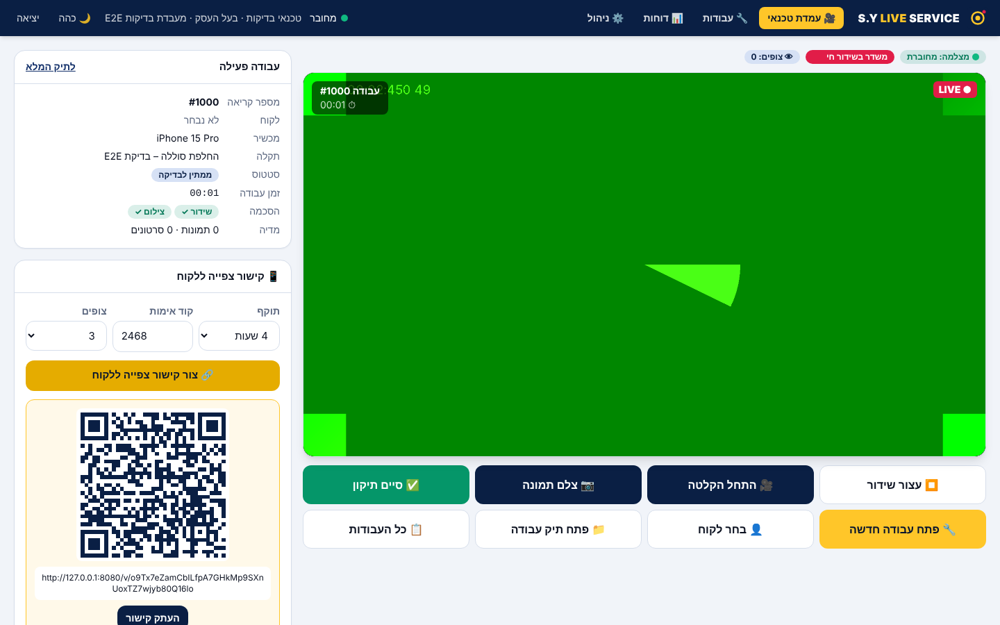

# S.Y LIVE SERVICE

**Smart Service Monitoring & AI Documentation Platform**

מערכת לתיעוד עבודות שירות בזמן אמת: מצלמת USB בעמדת הטכנאי, שידור חי מאובטח ללקוח בטלפון, הקלטה מקומית, צילום תמונות וניהול קריאות שירות. המערכת בנויה לעבודה של כמה עסקים במקביל (Multi-tenant), כבסיס למודל SaaS.

> **מצב הפרויקט: MVP (שלב 1).** המסלול המרכזי עובד ונבדק אוטומטית מקצה לקצה:
> מצלמה ← עמדת טכנאי ← שרת שידור ← קישור מאובטח ← צפייה בטלפון.
> הבדיקה נעשתה עם **מצלמה מדומה** של Chromium. מצלמת EMEET PIXY 4K אמיתית ו-Windows אמיתי **עדיין לא נבדקו**. ראו [מגבלות ידועות](docs/LIMITATIONS.he.md).



## מה כלול

| רכיב | תיקייה | טכנולוגיה |
|---|---|---|
| שרת API | `server/` | Node.js 22, TypeScript, Fastify, PostgreSQL |
| ממשק משתמש (עמדת טכנאי, ניהול, צפיית לקוח) | `web/` | React 18, TypeScript, Tailwind CSS, RTL מלא |
| תוכנת Windows לטכנאי | `desktop/` | Tauri v2 (WebView2 + Rust) |
| שרת מדיה | `deploy/mediamtx.yml` | MediaMTX (WebRTC WHIP/WHEP) |
| פריסה | `docker-compose.yml`, `Dockerfile`, `deploy/` | Docker Compose, Caddy (HTTPS) |
| בדיקות | `server/test/`, `e2e/` | Vitest (API), Playwright (מקצה לקצה) |

## הפעלה מהירה (פיתוח)

```bash
npm ci
cp server/.env.example server/.env          # עריכה לפי הצורך
npm run migrate -w server                    # יצירת טבלאות
npm run build -w web
npm run dev -w server                        # http://localhost:8080
# שרת המדיה (בחלון נוסף): mediamtx deploy/mediamtx.local.yml  ← ראו docs/INSTALL.he.md
```

הוראות מלאות בעברית, כולל התקנה על השרת Dell R220 ובניית קובץ התקנה ל-Windows: **[docs/INSTALL.he.md](docs/INSTALL.he.md)**

## מסמכים

- [הוראות התקנה והפעלה](docs/INSTALL.he.md)
- [ארכיטקטורה ובחירת טכנולוגיות](docs/ARCHITECTURE.md)
- [תיעוד API](docs/API.md) (וגם Swagger חי בכתובת `/api/docs`)
- [אבטחת מידע, פרטיות ונושאים לבדיקה משפטית](docs/SECURITY_PRIVACY.he.md)
- [הערכת משאבים לשרת Dell R220](docs/SERVER_SIZING.he.md)
- [הפעלת מצלמת EMEET PIXY](docs/EMEET_PIXY_SETUP.he.md)
- [מגבלות ובעיות ידועות](docs/LIMITATIONS.he.md)
- [מפת דרכים: שלבים 2 ו-3, מודול AI, אינטגרציית CRM](docs/ROADMAP.he.md)

## בדיקות

```bash
npm test                     # 27 בדיקות API מול PostgreSQL אמיתי
npm run test:e2e             # מקצה לקצה: מצלמה מדומה ← WHIP ← MediaMTX ← WHEP ← "טלפון"
cargo test --manifest-path desktop/src-tauri/Cargo.toml
```
